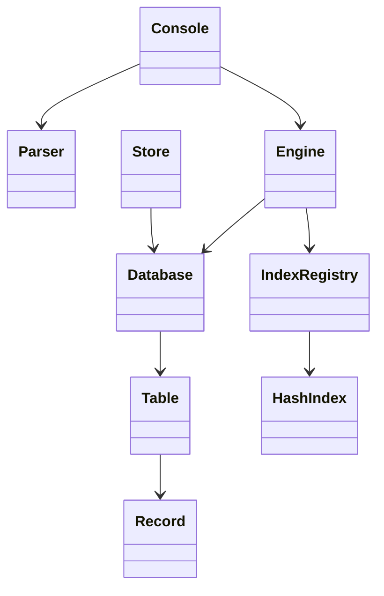
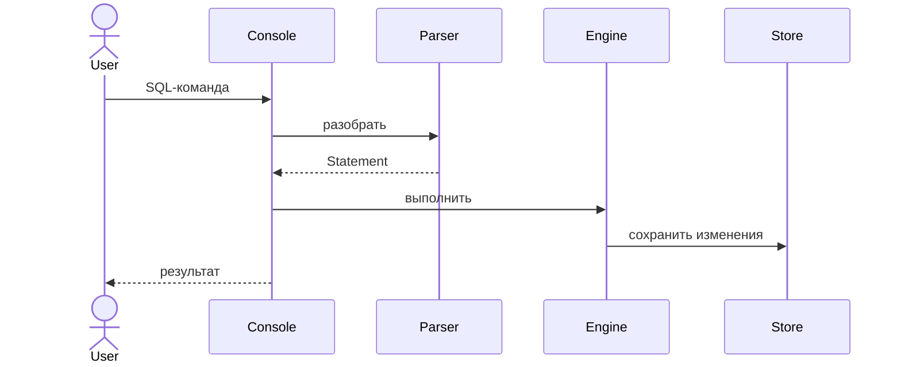

# Лабораторная работа 2. Файловая СУБД

Консольная СУБД на Java 8+ с SQL-подобными командами, связанными таблицами и hash-индексами. Данные и описания индексов сохраняются в `data/database.dat`.

## Запуск

Нужны JDK 8+ и Maven. Команды выполняются из папки проекта:

```text
mvn clean test
mvn package
java -cp target\classes ru.lab.db.Main
```

Для генерации Javadoc: `mvn javadoc:javadoc`. Введите `exit`, чтобы закрыть программу. При первом запуске создаются пустые таблицы.

## Таблицы и типы

Встроенная база хранит работодателей и их вакансии:

| Таблица | Поля |
| --- | --- |
| `employers` | `id` INTEGER - первичный ключ; `name` STRING; `verified` BOOLEAN (по умолчанию FALSE) |
| `vacancies` | `id` INTEGER - первичный ключ; `title` STRING; `salary` DOUBLE (по умолчанию 0); `published` DATE; `remote` BOOLEAN (по умолчанию FALSE); `employer_id` INTEGER - ссылка на `employers.id` |

Поддерживаются INTEGER, DOUBLE, STRING, DATE (`'YYYY-MM-DD'`), BOOLEAN (`TRUE`/`FALSE`) и `NULL` для nullable-полей. Зарплата не может быть отрицательной. Первичные ключи уникальны; нельзя удалить или изменить ключ работодателя, на который ссылаются вакансии. Имена команд, таблиц и полей нечувствительны к регистру.

## Команды

Поддерживаются `INSERT INTO`, `SELECT`, `UPDATE`, `DELETE`, `CREATE TABLE`, `DROP TABLE`, `CREATE INDEX` и `DROP INDEX`. Условие `WHERE` - одно сравнение с `=`, `!=`, `<`, `>`, `<=` или `>=`; у `UPDATE` и `DELETE` оно необязательно. Без него операция применяется ко всем строкам.

```sql
INSERT INTO employers VALUES (1, 'Acme', TRUE);
INSERT INTO vacancies (id, title, salary, published, employer_id) VALUES (101, 'Java developer', 120000, '2026-10-01', 1);
SELECT title, salary FROM vacancies WHERE salary > 20000;
UPDATE vacancies SET salary = 130000 WHERE id = 101;
DELETE FROM vacancies WHERE id = 101;
CREATE INDEX idx_title ON vacancies (title);
CREATE TABLE notes (id INTEGER PRIMARY KEY, message STRING DEFAULT 'empty');
DROP TABLE notes;
```

Частичный `INSERT` использует значения по умолчанию; иначе пропущенное поле должно допускать `NULL`. Для BOOLEAN доступны только `=` и `!=`; сравнение строк чувствительно к регистру, а сравнение с `NULL` не находит строк. Индекс ускоряет поиск по равенству. Сложные условия, `IS NULL` и объявление внешних ключей в `CREATE TABLE` не поддерживаются.

## Хранение и архитектура

Таблицы и индексы сохраняются после каждой изменяющей команды; при запуске индексы восстанавливаются из данных. Запись проходит через временный файл. После ошибки сохранения изменение в памяти не откатывается. Форматы данных старых версий автоматически не мигрируются.





## Тесты и производительность

Тесты запускаются командой `mvn clean test`. Бенчмарк повторяется так:

```text
mvn test-compile
java -cp "target\test-classes;target\classes" ru.lab.db.PerformanceBenchmark
```

Поиск по уникальному имени в таблице из 30 000 работодателей; 150 запросов для прогрева, медиана пяти раундов по 600 запросов. Замер не включает создание данных и индекса.

| Без индекса | С hash-индексом | Ускорение |
| ---: | ---: | ---: |
| 2324,914 мс | 1,404 мс | 1656,04 раза |

Измерено на Windows 10 с JDK 27.0.1.0.3; результаты зависят от компьютера и JVM.

## Выводы и источники

Реализованы связанные таблицы, CRUD и DDL-команды, файловое хранение и индексирование. Использованы документация Java SE 8 (`java.io`, `java.time`) и Apache Maven.

## Участники и вклад

- **Александр Щенников** - модель данных, связанные таблицы, ограничения и файловое хранение.
- **Артём Павлов** - SQL-парсер, выполнение запросов, консольный интерфейс и hash-индексы.

Тестирование и документацию подготовили совместно.
